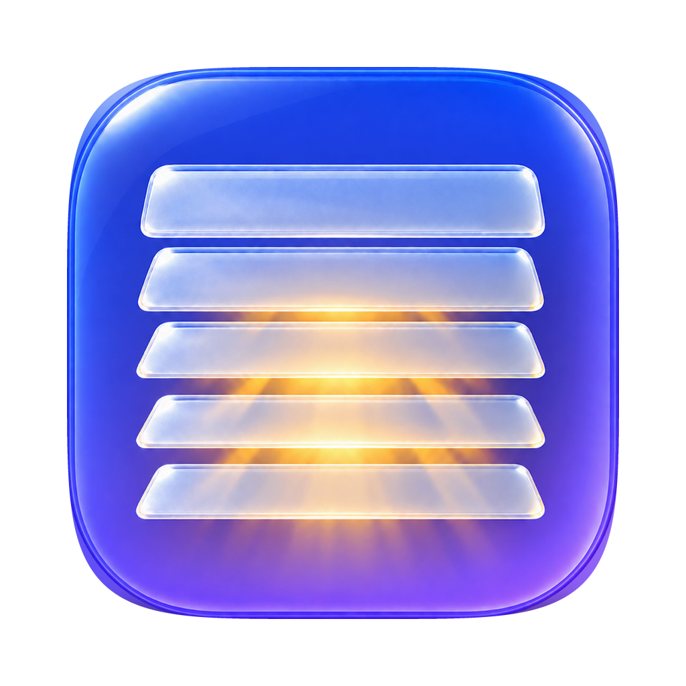

<p align="center"></p>
<h1 align="center">Persiana</h1>
<p align="center">Hide the menu bar icons you don't need. Show them with one click.</p>
<p align="center"><strong>English</strong> · <a href="README.es.md">Español</a></p>
<p align="center">
  
  
  <a href="LICENSE"></a>
</p>

Persiana is a small menu bar app for macOS 27. It keeps the icons you rarely use out
of sight and brings them back when you need them.

## What it does

- Hides the menu bar icons of the apps you choose, and shows them again with one click.
- Hides them again by itself once the pointer leaves the menu bar, after a delay you
  pick: 2.5 s, 5 s, 10 s, 30 s or never.
- Uses its own icon as the boundary, so you arrange what hides with the same
  ⌘-drag you already use to reorder the menu bar.
- Walks you through the Accessibility permission and an animated tutorial on first
  launch. The tutorial is always available from the menu.
- Speaks English and Spanish.
- Keeps itself up to date: a new version shows up in its menu and installs with one
  click.

## How to use

1. Hold ⌘ and drag the icons you want to hide to the left of the Persiana icon.
   Icons to its right always stay visible. The first time, Persiana places its icon
   next to macOS's own icons, so app icons start on the hidden side.
2. Click Persiana to show the hidden icons.
3. Move the pointer away from the menu bar. The icons hide again after your delay,
   or right away when you click Persiana again.
4. Right-click (or Control-click) Persiana for Settings, How it works, About and Quit.

## Requirements

- macOS 27 or later.
- A Mac with Apple Silicon.
- Persiana must run from `/Applications`. When it runs from any other folder,
  including `~/Applications`, macOS hides Persiana's own icon too.

## Install

1. Download the latest Persiana DMG from
   [Releases](https://github.com/StevenACZ/Persiana/releases/latest).
2. Open it, drag Persiana into Applications and open Persiana from there.
3. Allow Persiana in System Settings › Privacy & Security › Accessibility when the
   setup window asks.
4. Follow the short tutorial, then arrange your icons with ⌘-drag.

## Privacy and updates

Persiana does not request Screen Recording and does not read keystrokes.
Accessibility is used only to read where each menu bar icon sits. Settings stay on
your Mac. See [Security and privacy](SECURITY.md).

Its only network access is the update check against GitHub Releases. When a new
version is out, Persiana's menu offers it, and it installs only when you choose to.
You can turn automatic checks off in Settings › Updates. Development builds do not
use the public update feed.

## Limitations

- Hiding works per app. An app with several menu bar icons hides or shows all of
  them together.
- macOS keeps icons visible only for apps inside `/Applications`. Icons of apps in
  any other folder, including `~/Applications`, hide even to the right of Persiana,
  and Persiana's menu names them.
- macOS's own items, such as the clock, Wi-Fi, battery and Control Center, always
  stay visible. You can turn most of them off in System Settings › Menu Bar.
- Persiana needs macOS 27. On macOS 26 and earlier, apps such as Ice or Hidden Bar
  still work with the classic divider approach.

## Build from source

Requires Xcode with the macOS 27 SDK and an Apple Development signing identity.

```bash
make check
make install-dev
```

`make check` runs the format lint, the tests and a signed Release build.
`make install-dev` installs the build into `/Applications`. See
[development](docs/development.md) and [contributing](CONTRIBUTING.md).

## How it works

On macOS 27 the whole menu bar is drawn in a single window owned by MenuBarAgent,
so the old trick of a wide divider item that pushes icons off screen no longer
works. Persiana reads where each icon sits through the Accessibility API, positions
only. It then asks macOS, through the private MenuBarClientCore visibility
restriction that assessment mode uses, to show only the apps on the visible side of
its icon. macOS hides the rest and reflows the bar.

If that private API is missing or fails, Persiana fails open and shows everything.

## Credits

[Hidden Bar](https://github.com/dwarvesf/hidden) from Dwarves Foundation (MIT) uses
the same macOS 27 technique. Persiana's Objective-C boundary to MenuBarClientCore
follows Hidden Bar's approach.
See [third-party notices](THIRD_PARTY_NOTICES.md).

## License

[MIT](LICENSE)
